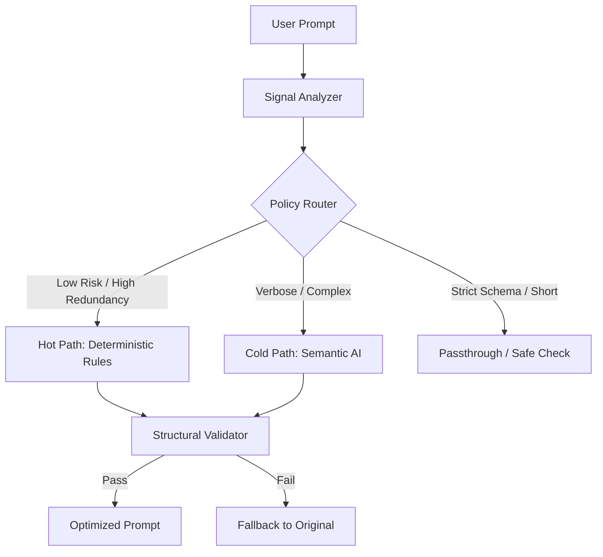

# ⚡ TokenWiseAI: LLM Token Optimization Engine

> An intelligent middleware engine that minimizes LLM API costs and latency by dynamically routing, optimizing, and validating prompts while guaranteeing strict output integrity.

[](https://fastapi.tiangolo.com/)
[](https://nextjs.org/)
[](https://groq.com/)

---

## 📊 The Problem
Modern LLM applications suffer from bloated prompts, leading to:
1. **High API Costs:** Unnecessary context wastes money on every request.
2. **Increased Latency:** Processing excessive tokens slows down Time-To-First-Byte (TTFB).
3. **Context Window Limits:** Bloated prompts lead to truncated or failed requests.

Existing solutions blindly truncate text or summarize everything. They do not make optimization decisions based on available token budgets, structural risk, or expected quality impact, often breaking strict output formats (like JSON) or dropping critical constraints.

## 🎯 The Solution
OptiPrompt acts as a smart triage system. Instead of blindly applying an LLM to every request, it uses a **Signal-Based Policy Router** to calculate budget pressure, estimated savings, and constraint risk, routing each prompt to the most efficient optimization path.

**Key Results:**
- Achieved **40–60% token compression** on verbose, complex prompts.
- **100% Structural Integrity:** Guaranteed preservation of strict JSON/XML schemas via Immutable Payload Extraction.
- **Zero-Cost Fallbacks:** Short, high-risk prompts are intelligently bypassed to prevent hallucination and save API costs.

---

## 🏗️ Architecture: Hot/Cold Path Routing



### The 3 Routing Signals
The router calculates three explicit, measurable values to make its decision:
1. **Budget Pressure ($P$):** Calculated from token counts and the model's specific context limits ($P = T / B$).
2. **Estimated Savings ($G$):** Predicted using a fast, free rule-based proxy before spending API credits.
3. **Constraint Risk:** A rule-based classification detecting strict output formats (JSON, SQL, Code) and negative constraints.

---

## ✨ Key Features

- **Immutable Schema Extraction:** Physically separates JSON/XML schemas from the prompt before compression and reattaches them verbatim. This guarantees the AI never breaks downstream parsers, solving the common "summarization trap."
- **Structural Validator:** Ensures compression never accidentally destroys required formatting. Includes an automatic fallback to the original prompt if validation fails.
- **Offline Quality Benchmarking:** Includes an `LLM-as-a-Judge` evaluation pipeline to compare original vs. optimized outputs for Accuracy, Completeness, and Instruction Following (designed for shadow traffic sampling, not the hot path).
- **Smart Passthrough:** Intelligently bypasses optimization for short, highly constrained prompts where the latency/cost of compression outweighs the marginal token savings.

---

## 🛠️ Tech Stack

- **Backend:** Python, FastAPI, Pydantic, Tiktoken
- **Frontend:** Next.js, React, Tailwind CSS, Axios
- **AI/NLP:** Groq API (Qwen-27B), OpenAI-compatible SDK
- **Evaluation:** LLM-as-a-Judge, Structural Regex Parsing

---

## 📦 How to Run Locally

### 1. Backend Setup
```bash
cd backend
python -m venv venv
source venv/bin/activate  # Windows: venv\Scripts\activate
pip install -r requirements.txt
```
Create a `.env` file in the `backend` folder with your Groq API key:
```env
GROQ_API_KEY=gsk_your_api_key_here
```
Run the FastAPI server:
```bash
uvicorn app.main:app --reload
```

### 2. Frontend Setup
Open a new terminal:
```bash
cd frontend
npm install
npm run dev
```
Open [http://localhost:3000](http://localhost:3000) in your browser.

---

